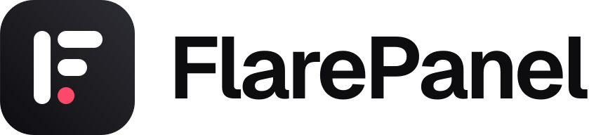

<p align="center">
  <a href="https://flarepanel.dev">
    <picture>
      <source media="(prefers-color-scheme: dark)" srcset="brand/wordmark-dark.svg">
      
    </picture>
  </a>
</p>

<p align="center">
  Open-source web and product analytics that runs entirely on Cloudflare.
</p>

<p align="center">
  <a href="https://flarepanel.dev">Website</a> ·
  <a href="https://docs.flarepanel.dev">Docs</a> ·
  <a href="https://dashboard.flarepanel.dev/onboarding">Get early access</a> ·
  <a href="https://flarepanel.dev/blog">Blog</a> ·
  <a href="https://status.flarepanel.dev">Status</a> ·
  <a href="https://x.com/FlarePanel">X</a>
</p>

---

FlarePanel gives you realtime dashboards, sessions and session replay, funnels,
retention, user profiles and an AI analyst, with no servers or databases to
run. Every part runs on Cloudflare's developer platform:

| Part | Runs on |
|---|---|
| Event intake, dashboard API, auth | Cloudflare Workers |
| Each project's events, sessions and rollups | One Durable Object per project |
| Raw event archive, session replay | R2 |
| Accounts, projects and settings | D1 |
| Background work (exports, insights, notifications) | Queues and Cron Triggers |

> **Early access.** Tracking, the dashboards, sessions and replay work today on
> the hosted service. Some reports are still being moved over; see
> [what works today](https://docs.flarepanel.dev/getting-started/status).

## Use it

- **Hosted:** create an account at
  [dashboard.flarepanel.dev](https://dashboard.flarepanel.dev/onboarding), add a
  project and paste the snippet. Early access is free while billing is set up.
- **Self-hosted on Cloudflare:** deploy the same code to your own Cloudflare
  account. It needs the Workers Paid plan. Follow the
  [deploy guide](https://docs.flarepanel.dev/self-hosting/deploy).
- **Self-hosted on your own server:** run it with Docker on one Linux machine
  (ClickHouse, Redis, Redpanda). See [`self-hosting/`](self-hosting/README.md)
  or the [server guide](https://docs.flarepanel.dev/self-hosting/server).

```html
<script>
  window.op=window.op||function(){var n=[];return new Proxy(function(){arguments.length&&n.push([].slice.call(arguments))},{get:function(t,r){return"q"===r?n:"call"===r||"apply"===r||"bind"===r?t[r]:function(){n.push([r].concat([].slice.call(arguments)))}},has:function(t,r){return"q"===r}})}();
  window.op('init', { clientId: 'YOUR_CLIENT_ID', trackScreenViews: true });
</script>
<script src="https://flarepanel.dev/op1.js" defer async></script>
```

SDKs for the browser, React, Next.js and servers are on npm under
[`@flarepanel`](https://www.npmjs.com/org/flarepanel).

## Coming from OpenPanel

FlarePanel is a fork of [OpenPanel](https://github.com/Openpanel-dev/openpanel)
and speaks the same tracking protocol, so an existing OpenPanel SDK keeps
working when you point its `apiUrl` at your FlarePanel API. See
[Coming from OpenPanel](https://docs.flarepanel.dev/getting-started/openpanel).

## Development

```bash
bun install
bun run codegen
bun run typecheck
bun run test
```

See [CONTRIBUTING.md](CONTRIBUTING.md) for the full setup and
[SECURITY.md](SECURITY.md) to report a vulnerability.

## License

The platform is [AGPL-3.0](LICENSE.md), like OpenPanel. The client SDKs in
`packages/sdks` are MIT. See [NOTICE.md](NOTICE.md) for attribution and what
changed from OpenPanel.

FlarePanel is an independent project. It is not affiliated with or endorsed by
OpenPanel or Cloudflare.
